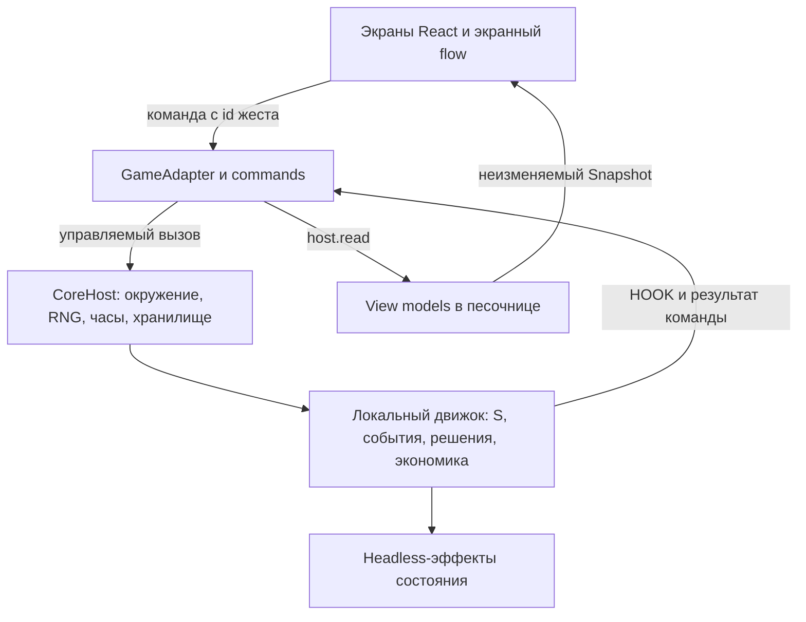

# Архитектура самостоятельной мобильной версии

Обновлено 2 ноября 2026 года. Приложение исполняет локальные исходники `src/engine/`, а мобильный интерфейс обращается к ним через хост и адаптер. Правила основаны на опубликованной версии 0.8.98 beta; история выделения, исходные хеши и границы совместимости описаны в [independent-engine.md](independent-engine.md). Предыдущий документ мобильной архитектуры учтён в [описи переноса](documentation-import-2026-11-02.json).

| Область | Ответственность | Граница |
|---|---|---|
| [src/engine](../src/engine/) | Пять языковых модулей, локальная ERA, формулы, таблицы, события и состояние `S` | Старый UI и серверные сервисы не входят в активный движок |
| [src/core/runtime.ts](../src/core/runtime.ts), [env.ts](../src/core/env.ts), [entropy.ts](../src/core/entropy.ts) | Создание экземпляра, контролируемые глобальные объекты, часы, RNG, таймеры, хранение и песочница чтения | Единственная точка загрузки движка для браузера |
| [src/adapters](../src/adapters/) | Порядок команд, HOOK, игровые часы, снимки, представления и мобильная мета-экономика | Правила и цены берёт из движка; UI не пересчитывает их |
| [src/flow](../src/flow/) | Reducer, экранный стек, навигация | Не владеет состоянием персонажа |
| [src/screens](../src/screens/), [src/ui](../src/ui/) | Отображение и ввод | Получают view models и отправляют команды через адаптер |
| [src/design](../src/design/) | Токены и параметры движения | Общие параметры представления, без игровых бросков RNG |
| [src/i18n](../src/i18n/) | Переводы UI, выбор локали, формы чисел | Игровые тексты приходят из локального языкового движка |
| [design/claude-canvas](../design/claude-canvas/) | Сохранённые макеты и материалы дизайна | Исторический источник интерфейса, не библиотека симуляции |

## Состояние и команды

Единственный изменяемый персонаж — `S` внутри экземпляра движка. React получает неизменяемый `Snapshot`; отдельной копии персонажа в flow нет. Доля игрового года публикуется отдельной подпиской, чтобы обновление индикатора времени не требовало пересборки всего экрана.

`GameAdapter` проверяет id жеста, `lifeSeq` и id ожидающего решения. `commands.ts` воспроизводит порядок изменения состояния при рождении, показе свидетельства, начале жизни, ответах, покупках и настройках. Повторная команда отклоняется. При рождении четыре сопутствующие жизни вычисляются локально; это синтетические сравнения, а не другие пользователи.

`state-effects.js` сохраняет нужные изменения, которые прежде выполнялись во время отрисовки: ленивые поля семьи, внешность, жильё, учёба и логическое состояние кольца переводов. Старый Canvas/DOM-рендер не запускается. Это часть совместимости правил; подробности и точные проверки — в [описании движка](independent-engine.md).

## Время, случайность и чтения

Браузерные кадры переводятся в фиксированные шаги `STEP_SECONDS = 1/60`; длительность кадра ограничена 0,25 с. Время идёт на Life при видимой вкладке, без результата решения. Пауза и ожидающее решение останавливают симуляцию. Ограничение первых 700 мс окна решения защищает от случайного ответа.

Игровой `Math.random` связан с `CoreEntropy`. Сопутствующие жизни получают отдельный поток от состояния `entropy ^ 0x5bd1e995`; анимации используют поток представления. Один начальный вызов представления сохранён для совместимости порядка, игровой поток при загрузке не сдвигается.

`host.read()` временно подставляет копию `S` и поток представления. После чтения восстанавливаются изменяемые верхнеуровневые значения, `S`, RNG, UI-кеши и кольцо переводов. Запись в хранилище или постановка игрового таймера из чтения считается ошибкой. Поэтому построение вкладки или анимация не должны менять будущую жизнь.

## Локальная ERA и сохранения

Для прошлого и будущего загружается собственный `src/engine/era.js`. Адаптер ждёт ERA до рождения, восстановления сохранения и переноса жизни в другой язык или валюту: функции стран, цен и продолжительности жизни сразу получают правильную эпоху. Ошибка загрузки не заменяется сегодняшними показателями.

Формат сохранения `{S, at}`, внутренние ключи `one8b.*` и префикс `1in8b-mobile/v1:` сохранены для совместимости. С каждой записью хост сохраняет состояние потока; языковые ключи жизни и архива сводятся к общему профилю. Раздельные origins портов разработки изолируют данные эксперимента и резервной мобильной версии. Детали текстов и ключей — в [локализации](localization.md).

Мета-экономика (`meta.ts`, `vm/rewards.ts`) хранит энергию, доллары, кристаллы и ожидающую награду отдельно от `S`. Она читает итог жизни, но не меняет её RNG и формулы.

## Сервисы и проверки

Обычной игре нужен статический сервер файлов. API статистики, облака, платежей, сообщества и лаборатории оригинальной страницы не подключены. Отсутствующие сервисы не имитируют успех. Назначение удалённых частей описано в [аудите сервисов](service-audit-2026-11-02.ru.md).

`npm run check` проверяет локальные зависимости, типы и самостоятельные тесты; `npm run build` собирает собственные исходники; `npm run verify:build` сравнивает минифицированные модули с ними. Прямая сверка с историческими сборками — отдельный необязательный инструмент разработки. Покрытие и практические ограничения перечислены в [testing.md](testing.md) и [verification-summary.json](verification-summary.json).

Журнал команд одной жизни описан в [replay-format.md](replay-format.md). Он пока не фиксирует всю межжизненную память, поэтому воспроизведение второй и последующих жизней не гарантируется. Восстановление Retry после fatal-ошибки также остаётся отдельной задачей.

Для следующего этапа переносимы команды, формат состояния, сценарии, [карта экранов](screen-map.md), [параметры движения](motion-spec.md) и материалы дизайна. Перенос правил в C# потребует отдельной реализации и сравнения по тем же сценариям.
